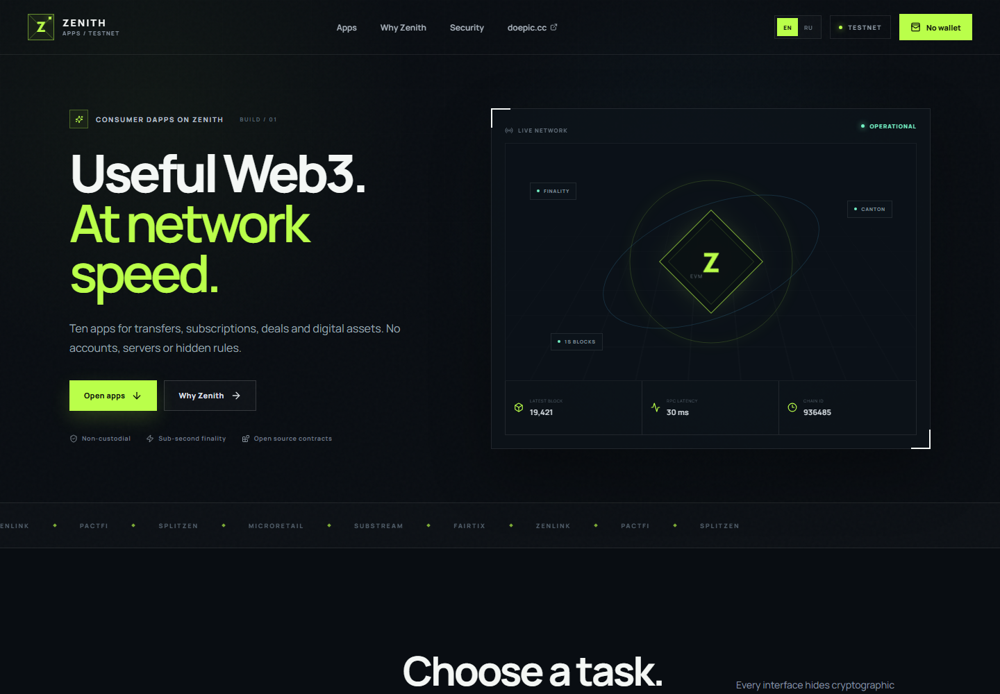
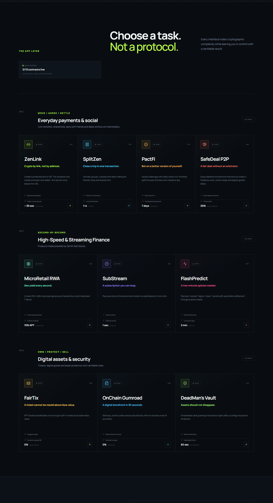
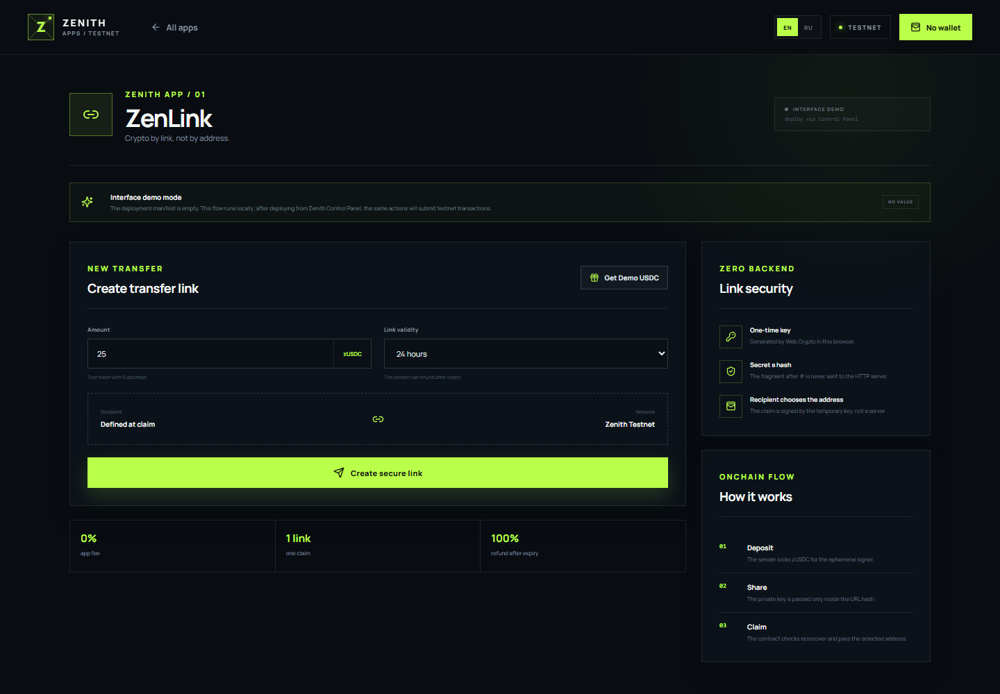

<div align="center">
  

# ZENITH APPS

### Ten consumer dApps for Zenith EVM Testnet

Payments, streaming finance and digital assets in one static, bilingual application suite.


</div>

Zenith Apps is a static-first application layer for everyday onchain products. It turns ten smart-contract concepts into complete end-user flows: link transfers, shared expenses, social challenges, protected P2P deals, tokenized savings, payment streams, short prediction rounds, fair-resale tickets, digital goods and inheritance vaults.

The default checkout is immediately usable in **Interface Demo** mode. When contract addresses are added to the deployment manifest, the same screens switch to **onchain mode** and submit transactions through an EIP-1193-compatible wallet. There is no application backend, and the interface can be hosted at a domain root or inside a static-site subdirectory.

> [!WARNING]
> Zenith Apps targets **Zenith EVM Testnet only**. ZTH and zUSDC have no real-world value. The bundled contracts contain explicit demo mechanics and should be treated as unaudited, non-production software. Never use real assets or production keys.



## Why Zenith Apps

- **Ten focused consumer flows** — each app solves a recognizable task instead of exposing protocol primitives.
- **Demo before deployment** — every interface works locally while the deployment manifest is empty.
- **Progressive onchain activation** — deployed apps become live independently as addresses appear in the manifest.
- **Standard wallet support** — connect, add or switch networks, read balances and sign transactions through EIP-1193 and ethers v6.
- **Static and embeddable** — relative assets and hash routes work on GitHub Pages, custom domains and subdirectory deployments.
- **Open contract layer** — Solidity sources, generated ABIs and deployment metadata are included in the repository.
- **Bilingual UI** — the complete application can be switched between English and Russian.

## Application catalog

| Category | App | What it does | Contract |
| --- | --- | --- | --- |
| Payments & social | **ZenLink** | Locks zUSDC behind a one-time link or QR and lets the recipient choose the claim address. | `EscrowVault` |
| Payments & social | **SplitZen** | Tracks group expenses, nets balances and settles a shared tab in token transfers. | `GroupTab` |
| Payments & social | **PactFi** | Runs stake-backed habit challenges with daily check-ins and a shared winner pool. | `HabitPool` |
| Payments & social | **SafeDeal P2P** | Protects a buyer and seller with dual collateral, hashed terms and mutual confirmation. | `SafeDealP2P` |
| Streaming finance | **MicroRetail RWA** | Demonstrates an ERC-4626-style savings vault backed by a mock tokenized T-Bond. | `MockTBondVault` |
| Streaming finance | **SubStream** | Unlocks subscription payments second by second and refunds unused deposits on cancellation. | `SubStream` |
| Streaming finance | **FlashPredict** | Runs two-minute pari-mutuel higher/lower rounds against a demo BTC/USD oracle. | `FlashPredict` |
| Digital assets | **FairTix** | Issues NFT tickets whose built-in resale price cannot exceed face value. | `FairTix` |
| Digital assets | **OnChain Gumroad** | Sells digital access directly and produces a deterministic onchain license proof. | `DigitalShop` |
| Digital assets | **DeadMan's Vault** | Releases deposited assets to configured beneficiaries after the heartbeat expires. | `DeadMansVault` |



## How it works

1. **Discover** — browse all ten product flows without connecting a wallet.
2. **Resolve mode** — the frontend loads `public/deployments/zenith-testnet.json` and checks each contract address independently.
3. **Simulate or sign** — an app without an address runs a local UI simulation; a live app requests approval and execution through the connected wallet.
4. **Confirm** — onchain actions wait for a transaction receipt and link the result to Zenith Explorer.

### Interface Demo mode

The repository intentionally ships with an empty deployment manifest. Forms, validation, generated content and state transitions remain usable, but no transaction is broadcast and no value moves. Each app clearly displays `INTERFACE DEMO` and `NO VALUE` while in this mode.

### Onchain mode

After deployment, the manifest maps stable application keys such as `zenlink`, `substream` and `fairtix` to contract addresses. The frontend then uses the bundled ABI, Zenith public RPC for reads and the user's injected wallet for writes. Partial deployments are supported, so one app can be live while another remains a demo.



## Quick start

### Requirements

- Node.js 22+
- npm
- A modern browser
- Optional for onchain use: an EIP-1193-compatible wallet and testnet ZTH for gas

```bash
git clone https://github.com/arsenikt/ZenithDapps.git
cd ZenithDapps
npm ci
npm run dev
```

Open `http://127.0.0.1:5174`. The development server uses a strict port, so startup stops if port `5174` is unavailable.

Run all project checks and verify the static Pages artifact:

```bash
npm test
npm run lint
npm run build:pages
```

### Available commands

| Command | Purpose |
| --- | --- |
| `npm run dev` | Start the local Vite server on `127.0.0.1:5174`. |
| `npm test` | Run the Vitest suite once. |
| `npm run lint` | Run ESLint across the project. |
| `npm run contracts:compile` | Compile all catalog contracts and regenerate frontend ABIs. |
| `npm run build` | Compile contracts, type-check TypeScript and create `dist/`. |
| `npm run build:pages` | Build and verify the embeddable GitHub Pages artifact. |
| `npm run preview` | Preview the production build locally. |

## Using Zenith Apps

### 1. Explore the product flows

Open any app from the catalog. With the default empty manifest, the workflow stays local and can be evaluated without a wallet or test tokens.

### 2. Connect an EVM wallet

For a deployed app, select **Connect wallet**. Zenith Apps requests access only when needed and prompts the wallet to add or switch to **Zenith EVM Testnet** if the active chain is different.

### 3. Fund the testnet account

Use the official Zenith faucet for ZTH gas. The suite's `DemoUSDC` contract also exposes a rate-limited faucet that issues 1,000 zUSDC once per hour when it is deployed and enabled.

### 4. Verify every result

The UI waits for the receipt before reporting success. Contract addresses and completed transactions can be opened directly in Zenith Explorer.

## Deploying the contract suite

The recommended operator is [Zenith Control Panel](https://github.com/arsenikt/ZenithControlPan), a separate Electron application that compiles, deploys, bootstraps and synchronizes the suite without exposing deployment keys to this frontend.

1. Open Zenith Control Panel and configure a testnet deployer plus the frontend manifest path.
2. Fund the deployer with testnet ZTH from the official faucet.
3. Run **Deploy full suite**; dependencies are deployed in catalog order and each confirmed receipt is saved.
4. Run **Bootstrap demo data** to authorize mock yield, fund the SafeDeal bot reserve, seed demo events and products, and populate the registry.
5. Select **Sync ZenithDapps** to write addresses into `public/deployments/zenith-testnet.json`.
6. Rebuild and publish the static frontend.

> [!IMPORTANT]
> The deployment manifest contains public addresses and transaction metadata only. Never place a private key, seed phrase or bearer token in the manifest or frontend source.

## Contract suite

The catalog contains **13 deployable contracts**: ten product contracts and three shared infrastructure contracts.

| Layer | Contracts |
| --- | --- |
| Infrastructure | `ZenithSuiteRegistry`, `DemoUSDC`, `DemoPriceOracle` |
| Payments & social | `EscrowVault`, `GroupTab`, `HabitPool`, `SafeDealP2P` |
| Streaming finance | `MockTBondVault`, `SubStream`, `FlashPredict` |
| Digital assets | `FairTix`, `DigitalShop`, `DeadMansVault` |

The compiler uses Solidity `0.8.30`, optimizer runs set to `300`, and the Cancun EVM target. `contracts/catalog.json` defines deployment order and constructor dependencies.

`npm run contracts:compile` generates:

| Output | Contents |
| --- | --- |
| `artifacts/contracts/*.json` | Full ABI, creation bytecode, deployed bytecode and constructor metadata. |
| `src/generated/contracts.ts` | Typed frontend ABI bundle used by ethers. |
| `public/contracts/manifest.json` | Public compiler and contract catalog metadata. |

Shared primitives include safe ERC-20 calls, reentrancy locks, pausable ownership and low-s ECDSA recovery. Demo-only behavior—accelerated yield, time warp, owner-controlled price movement and a bot counterparty—is intentionally isolated and visible in the product UI.

## Network configuration

| Parameter | Value |
| --- | --- |
| Network | Zenith EVM Testnet |
| Chain ID | `936485` (`0xe4a25`) |
| RPC | `https://rpc.testnet.zenith.network/` |
| Explorer | `https://explorer.testnet.zenith.network/` |
| Faucet | `https://explorer.testnet.zenith.network/faucet` |
| Native currency | ZTH, 18 decimals |
| Documentation | `https://docs.zenith.network/zenith-testnet` |

Zenith EVM exposes the standard wallet and JSON-RPC surface used by the app. Canton provides the underlying finality layer; it is not a second EVM network that must be added to MetaMask.

## Security model

- **No application backend** — the production artifact is static and talks directly to the wallet and public RPC.
- **No wallet custody** — the frontend never requests or stores a wallet seed phrase or account private key.
- **ZenLink secrets stay client-side** — the ephemeral key is generated in the browser and carried in the URL fragment, which is not sent in an HTTP request. Anyone with the complete link can claim, so share it through a private channel and consider browser-history and clipboard exposure.
- **Deployment keys stay separate** — owner keys belong in Zenith Control Panel, where they are protected with Electron `safeStorage` and the operating-system key store.
- **Demo trust assumptions are explicit** — the token faucet, oracle, accelerated yield, bot reserve and pause controls are not production-decentralization guarantees.
- **Testnet only** — the contracts have not been presented as production-audited code and must not hold assets with real-world value.

## Static deployment

### Standalone build

```bash
npm ci
npm test
npm run lint
npm run build:pages
```

Publish the resulting `dist/` directory with any static host. The build verifier checks required metadata, the Zenith chain ID and the absence of root-absolute asset paths.

### Embed in a parent GitHub Pages repository

The included composite action builds Zenith Apps as a submodule and copies it into a parent Pages artifact:

```yaml
- uses: ./zenith
  with:
    output-directory: site-dist/zenith
    node-version: '22'
```

Check out submodules recursively before this step, then upload the parent `site-dist` directory as the Pages artifact. Vite uses `base: './'` and the app uses hash routes, so URLs such as `#/app/zenlink` work without an SPA rewrite. `DoEpicCCWeb` uses this integration to serve the suite below `/zenith/` and route the dedicated subdomain to that artifact.

## Project structure

```text
contracts/                  Solidity sources and deployment catalog
docs/screenshots/           README product screenshots
public/contracts/           Public compiler and contract metadata
public/deployments/         Runtime Zenith Testnet address manifest
scripts/                    Contract compiler and Pages build verifier
src/config/apps.ts          Ten-app product catalog
src/context/                Wallet, contract and notification providers
src/pages/apps/             Individual dApp interfaces
src/generated/contracts.ts  Generated frontend ABIs
action.yml                  Reusable GitHub Pages build action
```

## Author and contacts

Developed by **Arseniy Troshin**.

- LinkedIn: [linkedin.com/in/arsenik](https://www.linkedin.com/in/arsenik/)
- Research: [DoEpic.cc — Crypto Currencies Research](https://doepic.cc/)
- GitHub: [github.com/arsenikt](https://github.com/arsenikt)

Zenith Apps is an independent testnet project and is not an official Zenith Network product.
